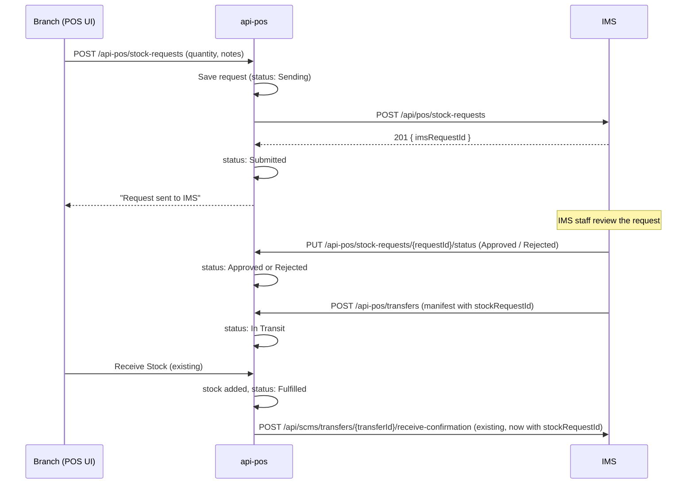

# Stock Request Integration (POS → IMS)

How a branch asks IMS for more stock from the POS **Stock Inventory** dialog, and how that request travels through IMS and comes back to the branch as a delivery.

This adds a new module to the existing POS–IMS integration. It reuses the same base URL, service keys and headers, and the existing delivery flow (transfer manifest → Receive Stock → receive confirmation).

> **Status (2026-11-25):** the POS side is built on branch `feat/stock-requests` in api-pos and web-pos (not merged yet). api-pos tests: 103 passing, 30 of them for this feature. The IMS side (§6) is not started, so until IMS has `POST /api/pos/stock-requests`, requests stay `Sending`. Cancel (§7) is not built.

> Naming: the UI says **IMS**. In code and config the same system is still called **SCMS** (`ScmsApiClient`, `SCMS_API_BASE_URL`, …). They are the same system.

---

## 1. The flow

**There is no approval in POS.** When the branch submits a request, POS sends it straight to IMS, and IMS approves or rejects it. If IMS approves, it ships the stock with the normal delivery flow. When the branch receives that delivery, the request is closed.



### Request statuses (kept in POS)

| Status | Meaning | Set by |
|---|---|---|
| `Sending` | Saved in POS, but IMS hasn't acknowledged it yet. POS retries automatically. | POS |
| `Submitted` | IMS has it and is deciding. | POS, when IMS answers the submit call |
| `Approved` | IMS will send `approvedQuantity` units. | IMS status call |
| `Rejected` | IMS won't send stock. `remarks` says why. This is final. | IMS status call |
| `In Transit` | IMS posted a delivery linked to this request. | POS, when the manifest arrives |
| `Fulfilled` | The branch received that delivery. This is final. | POS, on Receive Stock |
| `Cancelled` | The branch withdrew it before IMS decided. This is final. Optional, see §7. | POS |

Allowed moves:
- `Sending → Submitted`
- `Submitted → Approved`, `Rejected` or `Cancelled`
- `Approved → In Transit → Fulfilled`

POS refuses any other change with `409 Conflict`.

### What changes from today

Today the **Request Stock** button saves a stock *adjustment* in POS: `POST /api-pos/inventory/adjustments`, `adjustmentType: "Correction"`, status `PendingApproval`.
- Nothing is sent to IMS.
- Nothing in the POS UI ever approves it, so every request sits as `PendingApproval` forever.
- The quantity box also accepts negative numbers (down to −10000), which makes no sense for a request.

The new flow replaces this. Stock adjustments stay as they are for damage, loss and corrections, but **Request Stock stops using them**.

---

## 2. Shared conventions

These are unchanged from the current integration.

| | POS → IMS calls | IMS → POS calls |
|---|---|---|
| Base URL | `SCMS_API_BASE_URL` (env on api-pos) | the api-pos public URL |
| Auth | `Authorization: Bearer <SCMS_API_KEY>` | `Authorization: Bearer <SCMS_SERVICE_KEY>` (at least 32 characters) |
| Extra headers | `X-Correlation-ID` (new GUID per call), `X-Source-System: POS`, `Accept: application/json` | `Content-Type: application/json` |
| Body | JSON, camelCase | JSON, camelCase |
| Dates | ISO 8601 in UTC, e.g. `2026-11-16T06:30:00Z` | same |
| Branch id | the POS `locationId`, sent as a string (same as `destinationLocation.branchId` in transfer manifests) | same |
| Item match | **SKU** is the shared key between POS and IMS (same as manifests) | same |

**No new environment variables are needed.**

---

## 3. API contracts

### 3.1 POS → IMS: submit a request (IMS builds this)

`POST {SCMS_API_BASE_URL}/api/pos/stock-requests`

**Body: `StockRequestDto`**

| Field | Type | Required | Rules / notes |
|---|---|---|---|
| `requestId` | string | yes | POS's id, e.g. `SR-000123`. At most 50 characters. **Use it as the idempotency key**: POS retries, so the same `requestId` must never create two requests. |
| `branch.branchId` | string | yes | POS `locationId`, e.g. `"4"`. |
| `branch.branchName` | string | yes | e.g. `"TriNoma Bazaar"`. |
| `items` | array | yes | Exactly 1 item today (the dialog is per variation). It's an array so more items can be added later. |
| `items[].sku` | string | yes | Canonical SKU. IMS matches the product on this. |
| `items[].productId` | string | no | IMS's own product id (`Product.ScmsProductId` in POS), when known. |
| `items[].productName` | string | yes | Shown to IMS staff. |
| `items[].variationName` | string | yes | e.g. `"Pouch 250g"`. |
| `items[].quantity` | int | yes | 1 – 10000. Units requested. |
| `items[].currentStock` | int | yes | Branch on-hand when requested. This helps IMS decide. |
| `notes` | string | yes | 1 – 500 characters, no `<` or `>`. This is the **Request Details** box. |
| `requestedBy` | string | yes | Portal user id of the requester. |
| `requestedByName` | string | yes | Display name. |
| `requestedAt` | string (date) | yes | UTC. |

**Example**
```json
{
  "requestId": "SR-000123",
  "branch": { "branchId": "4", "branchName": "TriNoma Bazaar" },
  "items": [
    {
      "sku": "UBE-HAL-250",
      "productId": "prod_018",
      "productName": "Ube Halaya",
      "variationName": "Pouch 250g",
      "quantity": 6,
      "currentStock": 5
    }
  ],
  "notes": "Weekend bazaar, expecting double the usual sales.",
  "requestedBy": "u_7f3a",
  "requestedByName": "Ana Cruz",
  "requestedAt": "2026-11-16T06:30:00Z"
}
```

**Responses IMS must return**

| Case | Status | Body |
|---|---|---|
| Created | `201` | `{ "success": true, "data": { "requestId": "SR-000123", "imsRequestId": "req_551", "status": "Submitted" } }` |
| Same `requestId` already received | `200` | the same body as when it was created (do **not** create a duplicate) |
| Bad body (unknown SKU, bad branch, …) | `400` | `{ "success": false, "message": "items[0].sku UBE-X is not an IMS product." }` |
| Wrong or missing key | `401` | `{ "success": false, "message": "..." }` |

POS treats `200` and `201` as success. For `400`, `404`, `409` or `422`, POS marks the request `Rejected` and stores the `message` as remarks, so the branch sees the reason. For `5xx`, a timeout, or `401`/`403` (a key problem, not a verdict on the request), the request stays `Sending` and is retried.

### 3.2 IMS → POS: approve or reject (POS builds this)

`PUT /api-pos/stock-requests/{requestId}/status`, signed in with `SCMS_SERVICE_KEY`.

**Body: `StockRequestDecisionDto`**

| Field | Type | Required | Rules / notes |
|---|---|---|---|
| `status` | string | yes | `"Approved"` or `"Rejected"`. |
| `approvedQuantity` | int | if Approved | 1 to the requested quantity. Less than requested means a partial approval. Ignored when Rejected. |
| `remarks` | string | if Rejected | At most 500 characters, no `<` or `>`. Optional when Approved. |
| `imsRequestId` | string | no | IMS's id, stored for cross-reference. |
| `decidedBy` | string | yes | IMS user id. |
| `decidedByName` | string | yes | Display name, shown in POS. |
| `decidedAt` | string (date) | yes | UTC. |

**Example**
```json
{
  "status": "Approved",
  "approvedQuantity": 6,
  "remarks": "Will ship with Thursday's run.",
  "imsRequestId": "req_551",
  "decidedBy": "ims_u_12",
  "decidedByName": "Mark Reyes",
  "decidedAt": "2026-11-16T09:10:00Z"
}
```

**POS responses**

| Case | Status |
|---|---|
| Applied | `200` `{ "success": true, "data": { "requestId": "SR-000123", "status": "Approved" } }` |
| Same decision sent again | `200` (idempotent, nothing changes) |
| Unknown `requestId` | `404` |
| Invalid body (quantity over requested, missing remarks on reject, …) | `400` with `message` |
| Request is no longer undecided (already decided, cancelled, …) | `409` with `message` |

"Undecided" means `Submitted` **or** `Sending`. IMS can store the request and decide on it before POS has seen IMS's `201` (for example, the response timed out), so POS accepts the decision either way.

"Same decision sent again" means `Approved` with the same `approvedQuantity` (even after the request has moved on to `In Transit` or `Fulfilled`), or `Rejected` by the same `decidedBy`.

### 3.3 IMS → POS: ship it (existing endpoint, one new field)

`POST /api-pos/transfers` (the transfer manifest IMS already sends) gets one **optional** top-level field:

| Field | Type | Required | Rules / notes |
|---|---|---|---|
| `stockRequestId` | string | no | The POS `requestId` this delivery fulfils. Omit it for deliveries IMS sends on its own. |

When it's present, POS checks that:
- the request exists and is `Approved`;
- `destinationLocation.branchId` matches the request's branch;
- the manifest includes the requested SKU.

If any check fails, POS answers `400` and stores nothing, the same as other manifest errors. When the checks pass, the request moves to `In Transit`.

Rule: **one delivery per request.** Sending an approved request in several deliveries is out of scope for now (see §7).

### 3.4 POS → IMS: delivery received (existing call, one new field)

`POST {SCMS_API_BASE_URL}/api/scms/transfers/{transferId}/receive-confirmation` (`ReceiveConfirmationDto`) gets:

| Field | Type | Notes |
|---|---|---|
| `stockRequestId` | string or null | Copied from the manifest. It's informational, so IMS can close the request on its side. |

**IMS should close the request using `transferId`.** IMS already knows which transfer it sent for which request. `stockRequestId` in this payload is a backup: when the first confirmation fails, POS's reconciliation sweep retries with `PUT /api/StockTransfers/{transferId}/status` (`"Completed"` only), and that retry doesn't carry `stockRequestId`.

Nothing else in that payload changes. Received, damaged and missing counts work as they do today.

### 3.5 Branch UI → POS (internal, POS only)

| Method & path | Who | Purpose |
|---|---|---|
| `POST /api-pos/stock-requests` | Stock Management users with access to that branch | Create and send a request. |
| `GET /api-pos/stock-requests?locationId=&variationId=` | same | List requests for the dialog. Branch staff see only their own branches. |
| `PUT /api-pos/stock-requests/{requestId}/cancel` | same | Optional (§7). Only while `Sending` or `Submitted`. **Not built.** |

**`CreateStockRequestDto`** (UI → POS)

| Field | Type | Rules |
|---|---|---|
| `variationId` | int | Must be an active variation **with a SKU** (otherwise IMS can't match it). |
| `locationId` | int | A store or bazaar the user has access to. **Not** the Commissary, since stock ships *from* there. |
| `quantity` | int | 1 – 10000. No negatives, no zero. |
| `notes` | string | 1 – 500 characters, no `<` or `>`. |

POS fills in everything else in `StockRequestDto` itself: SKU, names, current stock, the requester from the session, and the time.

**`StockRequestResponseDto`** (POS → UI): `requestId`, `variationId`, `variationName`, `sku`, `locationId`, `locationName`, `quantity`, `approvedQuantity`, `receivedQuantity`, `notes`, `status`, `remarks`, `requestedByName`, `requestedAt`, `decidedByName`, `decidedAt`, `transferId`, `fulfilledAt`.

---

## 4. POS setup (api-pos)

### 4.1 Database: new table `StockRequests` (+ migration `AddStockRequests`)

| Column | Type | Notes |
|---|---|---|
| `Id` | int PK | identity |
| `RequestId` | varchar(50), unique | `SR-` + zero-padded `Id`, e.g. `SR-000123` |
| `VariationId` | int FK → ProductVariations | |
| `LocationId` | int FK → Locations | |
| `Sku` | varchar(100) | snapshot at request time |
| `Quantity` | int | requested |
| `CurrentStockAtRequest` | int | snapshot |
| `Notes` | varchar(500) | |
| `Status` | varchar(20) | see §1 |
| `ApprovedQuantity` | int null | |
| `ReceivedQuantity` | int null | from the linked delivery |
| `Remarks` | varchar(500) null | IMS's reason, or IMS's 400 message |
| `ImsRequestId` | varchar(100) null | |
| `RequestedBy` / `RequestedByName` | varchar | from the session |
| `RequestedAt` | timestamptz | |
| `SentAt` | timestamptz null | when IMS acknowledged it |
| `SendAttempts` | int | for the retry sweep |
| `LastSendError` | varchar(300) null | |
| `DecidedBy` / `DecidedByName` / `DecidedAt` | null | from IMS |
| `TransferId` | varchar(50) null, FK → StockTransfers | set when the manifest arrives |
| `FulfilledAt` | timestamptz null | |

Also add `StockRequestId varchar(50) null` to `StockTransfers`. Index `StockRequests (LocationId, Status)`.

As built (migration `AddStockRequests`): `TransferId` is an indexed column, not a foreign key. A unique partial index `(VariationId, LocationId) WHERE Status IN ('Sending','Submitted','Approved','In Transit')` enforces "one open request" even under a double submit.

### 4.2 Code to add or change

| # | Where | What |
|---|---|---|
| 1 | `Domains/Entities/StockRequest.cs`, `PosDbContext` | Add the entity, its configuration and `DbSet`. Add `StockRequestId` to `StockTransfer`. |
| 2 | `Api/Contracts/StockRequests/` | `CreateStockRequestDto`, `StockRequestResponseDto`, `StockRequestDecisionDto`. |
| 3 | `Api/Contracts/Scms/` | `StockRequestDto` (outbound, §3.1). Add `StockRequestId` to `TransferDetailsDto` and `ReceiveConfirmationDto`. |
| 4 | `Infrastructures/Externals/ScmsApiClient.cs` | `SubmitStockRequestAsync(StockRequestDto)`. Return success, a 400 message, or a transient failure, the same way `SyncLocationsAsync` reports results instead of throwing. |
| 5 | `Applications/Services/StockRequestService.cs` (new) | `CreateAsync`: validate, save as `Sending`, call IMS, then set `Submitted`, or `Rejected` on a 400, or keep `Sending`. Also `ListAsync`, `ApplyDecisionAsync`, `LinkTransferAsync`, `MarkFulfilledAsync`, `CancelAsync`. Register it in `Program.cs`. |
| 6 | `Api/Controllers/StockRequestsController.cs` (new) | The routes in §3.2 and §3.5. Use `RequireLocationAccess` for branch users. The status route accepts only the IMS service identity (`Role == "SCMS Service"`). |
| 7 | `Api/Middlewares/PortalSessionMiddleware.cs` → `GetRequiredModule` | Map `/api-pos/stock-requests` to **Stock Management**. **Required**: an unmapped path skips sign-in entirely. |
| 8 | `Api/Middlewares/ScmsServiceAuth.cs` → `IsServiceRoute` | Allow `PUT /api-pos/stock-requests/{requestId}/status` with the service key. |
| 9 | `Api/Controllers/TransfersController.cs` | Read `stockRequestId`, validate it as in §3.3, link the request, and set it to `In Transit`. |
| 10 | `Applications/Services/TransferReceivingService.cs` → `ReceiveAsync` | After stock is saved, if the transfer has a `StockRequestId`, set the request to `Fulfilled` and fill in `ReceivedQuantity` and `FulfilledAt`. Put `stockRequestId` in the confirmation sent to IMS. |
| 11 | `Applications/Services/StockRequestSenderBackgroundService.cs` (new) | Every 5 minutes, re-send requests still `Sending`. Stop after 12 attempts (about an hour) and leave them `Sending` with `LastSendError`, so the dialog can show "Couldn't reach IMS". Not added to `ScmsSyncBackgroundService` (an old prototype sync) or the 10-minute reconciliation sweep. |

### 4.3 Validation POS enforces on create

- `quantity` is a whole number from 1 to 10000.
- `notes` is 1 – 500 characters with no `<` or `>`.
- The variation is active and has a SKU.
- The location is active, not the Commissary, and in the user's branches. Super Admin, CEO and General Manager can pick any location.
- **One open request per variation per branch**: refuse a new one while another is `Sending`, `Submitted`, `Approved` or `In Transit`. The message points to the open request. This stops duplicate requests from double-clicks and impatience.
- Rate limit: reuse `[RateLimit(WindowSeconds = 5, MaxRequests = 1)]`, as on adjustments.

---

## 5. POS setup (web-pos)

| # | Where | What |
|---|---|---|
| 1 | `components/module-pos/StockAdjustmentFormDialog.tsx` | Quantity: `min={1}`, whole numbers only, **no negatives**. Rename "Request Details" to "Notes", or keep the label but send it as `notes`. Below the form, show this variation's requests at this branch with a status badge, quantities, IMS remarks and dates. Disable the form with a short message while a request is open. |
| 2 | `pages/pos/ViewStockManagement.tsx` → `handleAdjustmentSubmit` | Call `POST /api-pos/stock-requests` instead of `inventoryAdjustmentsCreate`. On `Submitted`, toast "Request sent to IMS." On `Sending`, toast "Saved. IMS couldn't be reached; it will be sent automatically." On `Rejected` from a 400, show IMS's message. |
| 3 | `components/module-pos/api/api.ts` | Regenerate from api-pos's Swagger, or call `apiClient.instance` directly as the page already does for movements. |
| 4 | `app/api/pos/[...path]/route.ts` | No change. The page calls `/api-pos/stock-requests` through the Next.js rewrite in `next.config`, not through the allowlisted `/api/pos` proxy. |
| 5 | Stock Management list (optional) | A small "Requests" badge or filter showing open requests per branch. |

Status badge colours: `Sending` grey, `Submitted` blue, `Approved` purple, `In Transit` amber, `Fulfilled` green, `Rejected` red, `Cancelled` grey.

---

## 6. IMS setup (for the IMS team)

1. **Receive requests:** `POST /api/pos/stock-requests` as in §3.1. Accept the POS bearer key, store the request, and **dedupe on `requestId`**.
2. **Review queue:** show IMS staff the branch, item, quantity, current stock, notes and requester. Let them approve with a quantity of at most the requested amount, or reject with remarks.
3. **Tell POS the decision:** call `PUT /api-pos/stock-requests/{requestId}/status` (§3.2) with `SCMS_SERVICE_KEY`. Retry on `5xx` or a timeout. A `409` means POS has already moved on, so stop retrying.
4. **Ship:** send the usual transfer manifest to `POST /api-pos/transfers` with `stockRequestId` set (§3.3). Use one delivery per request, and the quantity should be the `approvedQuantity`.
5. **Close:** when the transfer IMS shipped for the request is confirmed received (the receive-confirmation, or the status retry `PUT /api/StockTransfers/{transferId}/status` = `Completed`), mark the request complete on the IMS side. Match on `transferId`; `stockRequestId` in the confirmation is a backup (§3.4).

IMS needs nothing new from POS beyond what it already has: the base URL, both keys, the branch list from the location sync, and SKUs from the product sync.

---

## 7. Open points to agree with IMS

| Topic | Proposal |
|---|---|
| Cancel | Phase 2. The branch can cancel only while the request is `Sending` or `Submitted`. POS would call `PUT {IMS}/api/pos/stock-requests/{requestId}/cancel`. If IMS has already approved, IMS answers `409` and the cancel is refused. |
| Split shipments | Not supported. One delivery per request. If needed later, POS would keep the request `In Transit` until the received units reach `approvedQuantity`. |
| Approving more than requested | Not allowed (`approvedQuantity` ≤ `quantity`). IMS can tell the branch to request more instead. |
| Approved but never shipped | POS shows `Approved` indefinitely. If needed, IMS can send `Rejected` with remarks to close it. |
| Old `PendingApproval` "Correction" adjustments | They were never sent anywhere. Leave them; they don't change stock. |

---

## 8. Test checklist

- [ ] Request 6 units: the request appears as `Submitted` and IMS has it once, even if POS sent it twice.
- [ ] IMS down: the request is `Sending` and reaches IMS by itself once IMS is back.
- [ ] IMS rejects with remarks: POS shows `Rejected` and the remarks, and the branch can request again.
- [ ] IMS approves 4 of 6: POS shows `Approved · 4 of 6`.
- [ ] IMS ships with `stockRequestId`: POS shows `In Transit`, and the delivery appears in Receive Stock.
- [ ] The branch receives it: stock rises by the received count, the request is `Fulfilled`, and IMS gets the confirmation with `stockRequestId`.
- [ ] A manifest with the wrong branch, an unknown request or a request that isn't approved gets `400` and nothing is saved.
- [ ] Quantity 0, a negative number, over 10000, empty notes or `<script>`: refused.
- [ ] A second request for the same item while one is open: refused with a pointer to the open one.
- [ ] A cashier with no Stock Management access gets `403`. Branch staff can't request for another branch.
- [ ] The status endpoint called without the service key gets `401`. Called by a signed-in staff member, it gets `403`.
